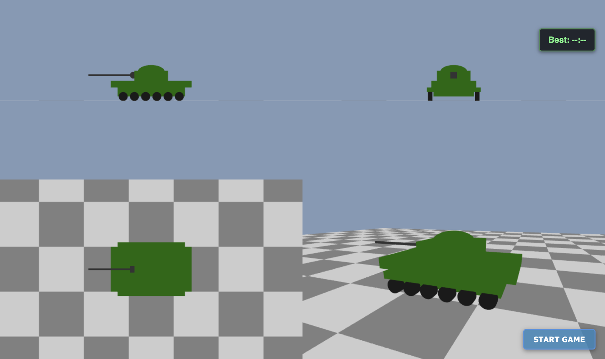

# 🍅 Tomato Tank — Computer Graphics and Interfaces, Project 2

<p>
  
  
  
  
  
</p>

**▶️ [Live demo](https://mccprogrammer.github.io/CGI-Tomato-Tank/)** — runs in the browser (desktop, keyboard needed).

Project 2 of *Computação Gráfica e Interfaces* (Computer Graphics and Interfaces), Computer Science degree at **NOVA School of Science and Technology (FCT NOVA)**.

<p align="center"></p>

## About

A 3D **tomato-launching tank** in WebGL, built with **hierarchical modelling**: the tank is a scene graph of cubes, cylinders and spheres where the cabin turns on the base, the cannon tilts on the cabin and the wheels spin as it moves — each part inheriting its parent's transformations through a matrix stack.

- Drive the tank, rotate the cabin, raise and lower the cannon and **shoot tomatoes** that follow a ballistic trajectory under gravity
- **Projections:** front, side and top orthographic views plus a fourth view that switches between **axonometric** and **oblique**, with adjustable angles; parallel or **perspective** projection; one view or all four at once
- Zoom with the mouse wheel, wireframe or solid rendering, no distortion when the window is resized
- A chequered floor made of cube instances
- **Extra:** a small game with 5 targets to hit against the clock, keeping your best time


## Running it

WebGL apps load their shaders with `fetch`, so they need to be served over HTTP (opening `index.html` directly won't work):

```bash
python3 -m http.server 8000
# then open http://localhost:8000
```

Press `h` in the app to see every key.

## What I learned

- Scene graphs and hierarchical transformations with a matrix stack
- Orthographic, axonometric, oblique and perspective projections and how to build their matrices
- Multiple viewports and keeping each camera framed on resize
- Simple physics and collision detection in a render loop

## Credits

- **Miguel Carmo** ([@MCCProgrammer](https://github.com/MCCProgrammer))
- **Tomás Ramos Alves** ([@Alvesss04](https://github.com/Alvesss04))

`libs/` (`MV.js` math library, `stack.js` matrix stack, `utils.js` and the primitive objects) was provided by the CGI teaching staff; the scene graph in `tank.json`, the app and the shaders were written by us.

---

<sub>The assignment statement is not included in this repository, as it belongs to the course's teaching staff. This is a student project shared for portfolio purposes.</sub>
